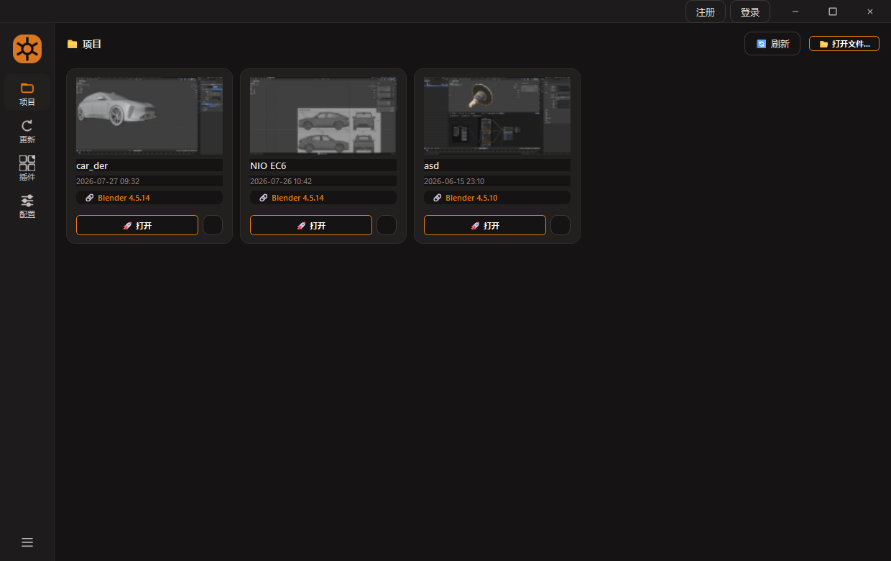
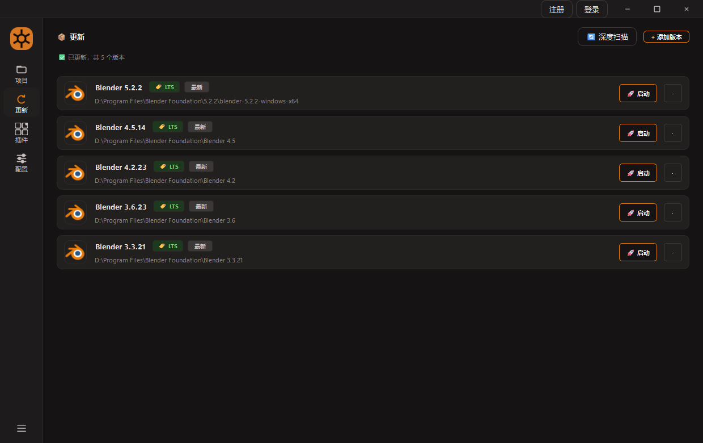
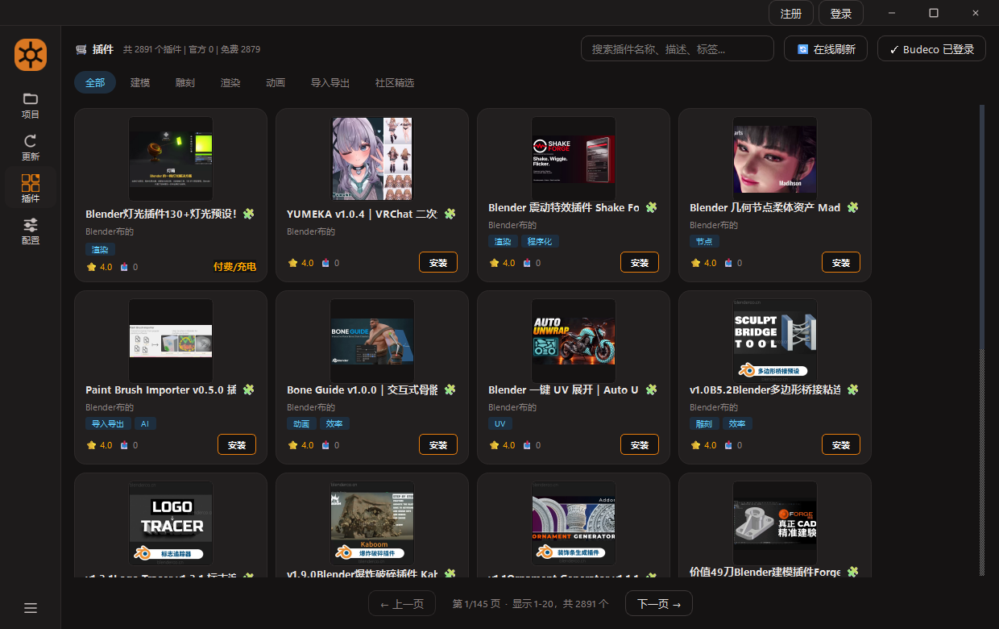
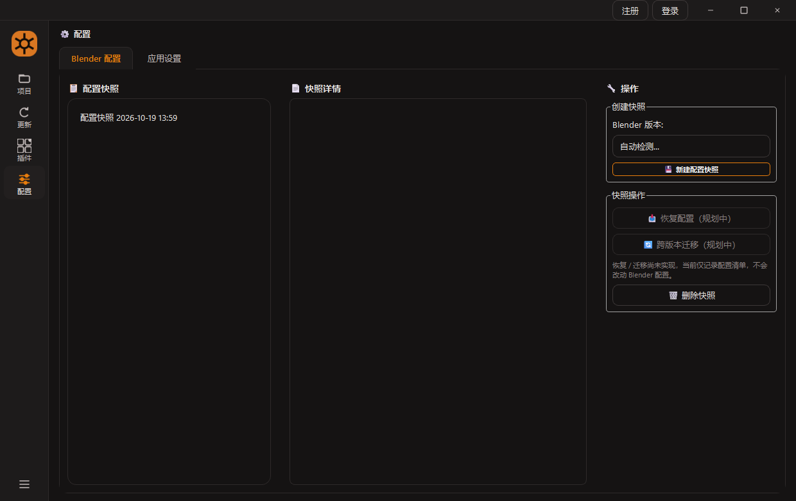

<div align="center">

# Blender Hub

**Blender 版本 / 项目 / 插件的一体化桌面管理工具**
*A unified desktop manager for Blender builds, projects & addons — Windows · PyQt6 · 100% local*

<p>


</p>

**🌐 语言：** [English](README.md) · [中文](README_zh.md)

</div>

---

## 💡 为什么做 Blender Hub

Blender 用久了，三个麻烦会反复出现：

1. **版本管不过来** —— 装了一堆版本，记不清默认是哪个、LTS 在哪，想装新版还得先去官网翻下载页；
2. **项目找不到** —— `.blend` 散落各处，翻资源管理器翻到烦；
3. **插件装得累** —— 网页下载、手动解压、再塞进 `scripts/addons`，装完还不确定兼不兼容当前版本。

Blender Hub 把这三件事收进一个界面：**自动发现本机版本、扫描项目（直接解析 `.blend` 内嵌缩略图）、在线安装插件**。
所有操作都在本机完成——不接管你的文件，不上传任何数据。

## ✨ 功能特性

### 📂 项目 Project Center

| | |
| --- | --- |
| 🖼 **真缩略图** | 直接解析 `.blend` 文件内嵌的预览图（TEST 块，已按 OpenGL 存储方向翻转），回退到同名图片、矢量占位图，带 mtime 缓存 |
| 📂 **目录扫描** | 自动扫描常用目录（文档/Blender、桌面、下载、`D:/BlenderProjects` 等），后台线程、可取消、实时进度 |
| 🔗 **版本绑定** | 每个项目记住「用哪个 Blender 打开」，绑定版本缺失时引导换版本 |
| 🚀 **快速打开** | 双击卡片或点按钮即可打开，也可手动选择任意 `.blend` 文件 |
| 🗂 **响应式网格** | 卡片按窗口宽度自动重排列数 |

### 🗂 更新 Version Manager

| | |
| --- | --- |
| 🔍 **自动发现** | 常见目录 + 注册表 + Steam + PATH + 全盘深度扫描，首屏本地缓存秒开、后台校验 |
| 🏷 **渠道徽章** | 每张卡片标注 LTS / 稳定 / 测试渠道，图标从 `blender.exe` 提取 |
| 🚀 **一键启动** | 点卡片即用对应版本启动 Blender |
| ⬇ **在线下载** | 稳定版 / LTS / 测试版三类可选；南京大学 / 清华 / 中科大 / 官方多镜像源；断点续传、实时进度 |
| 🧹 **安全删除** | 只删除本应用托管安装的版本，外部安装（Program Files / Steam）只提示、不代删 |
| 🔄 **更新提示** | 检测到同系列新版本时行内出现「可更新」，也可扫描导入系统中已有的安装 |

### 🛍 插件 Addon Store

| | |
| --- | --- |
| 🛍 **在线目录** | 浏览 BudecoTop 插件目录：关键词搜索、分类筛选、分页浏览，总量 / 官方 / 免费统计 |
| ⚠ **兼容检测** | 安装前按目标 Blender 版本比对 `min_blender` / `max_blender` 并给出警告 |
| 🧰 **三种安装链路** | ① 直链下载安装；② 网盘分享（自动解析链接 + 提取码）；③ 内嵌浏览器一体化安装（登录 → 点下载 → 自动拾取 zip） |
| 🔐 **登录方式** | QQ 扫码登录，或从本机 Firefox 只读同步 Cookie |
| 👀 **下载守望** | 轮询下载目录，发现新写完的 zip 自动校验并安装 |
| ✅ **安装包校验** | 安装前校验 zip 结构 / 大小 / 内容完整性 |

### 📸 配置 Config Center

页面分两个标签页：**Blender 配置**（快照清单）与**应用设置**（Blender Hub 自身偏好）。

| | |
| --- | --- |
| 📸 **配置快照** | 按 Blender 版本记录真实配置清单（配置目录文件 + 插件目录，本地 JSON） |
| 🔄 **恢复与迁移** | 规划中，入口已置灰；当前版本不会写回 Blender 配置目录 |
| ⚙️ **应用设置** | 下载镜像源（带可用性徽章）、Blender 安装位置、数据 / 日志目录、关于（版本 / MIT 许可 / 免责声明） |

### 🖥 外壳与体验 Shell

| | |
| --- | --- |
| 🎨 **深色沉浸主题** | 暖褐灰底 + Blender 橙（`#E87D0D`）强调色，14px 卡片圆角；全部图标由 QPainter 矢量绘制（2x HiDPI） |
| 🪟 **无边框窗口** | 自定义标题栏，Win11 系统级圆角、八向边缘缩放、窗口几何记忆 |
| 🧭 **窄侧栏导航** | 76px 图标导航，可展开 / 合并，状态跨会话持久化 |
| 📥 **全局下载条** | 底部真实进度条（百分比 + 速度），右下角 Toast 通知 |
| 🧩 **插件化架构** | 每个功能都是独立模块：`manifest.json` 声明、`ModuleManager` 动态加载、`EventBus` 通信 |
| 🛡 **排障友好** | 弹窗审计（谁弹的窗都有日志）、崩溃诊断（`faulthandler` 落盘）、模块签名校验（manifest + SHA-256） |

> **🌐 语言：** [English](README.md) · [中文](README_zh.md)

## 📸 截图 Screenshots

<!-- 将应用截图放入 docs/screenshots/ 目录，并按实际文件名更新下列路径 -->

| 项目 Project Center | 更新 Version Manager |
| :---: | :---: |
|  |  |

| 插件 Addon Store | 配置 Config Center |
| :---: | :---: |
|  |  |

## 🚀 快速开始

### 方式一：便携版（推荐）

从 Releases 下载 `BlenderHub` 压缩包，解压到任意目录，双击 `BlenderHub.exe` 即可使用——
onedir 便携结构，整目录拷走即用，无需安装。

### 方式二：源码运行

```bash
git clone https://github.com/zlwinny/blender-hub.git
cd blender-hub
pip install -r requirements.txt
python main.py
```

**环境要求**

- Windows 10 / 11 x64
- Python 3.11+（开发与打包实测 Python 3.14）
- Blender 任意已安装版本（没有也能启动，只是列表为空）

无显示环境（CI 冒烟）可设 `BH_OFFSCREEN=1`，应用会切到 `offscreen` 平台运行。

## 🏗 架构

核心层（`core/`）只负责外壳、服务与生命周期；所有业务功能都是 `modules/` 下的独立模块，
由 `ModuleManager` 读取 `manifest.json` 后动态加载。模块协作走 `EventBus`（Pub/Sub）与
`ModuleContext` 注入的服务；少量共享页面仍直接复用（例如设置页嵌入配置页）。

```
main.py                  # 入口：初始化 Qt / WebEngine → 构建外壳 → 加载模块
core/
├── app_context.py       # 应用上下文（服务装配）
├── main_window.py       # 外壳：标题栏 / 侧边导航 / 下载条 / Toast
├── module_manager.py    # 模块发现、manifest 校验、动态加载
├── api/module_api.py    # BaseModule / ModuleContext 接口定义
├── theme.py             # 设计令牌与主题
├── widgets.py           # 通用控件（Card / Toast / badge ...）
├── icons.py             # QPainter 矢量图标
├── popup_audit.py       # 弹窗审计（防重复 / 孤儿弹窗）
└── services/            # 事件总线、配置、日志、下载（队列 / 断点续传 / 镜像源）、
                         # 版本探测、插件目录、安装包校验、认证、签名校验
modules/                 # 功能模块（每个模块自带 manifest.json，order 决定侧边栏顺序）
├── project_center/      #   项目
├── version_library/     #   更新
├── addon_store/         #   插件
├── config_center/       #   配置
└── settings.py          #   应用设置页（嵌入配置页标签页）
tests/                   # 测试（unit / regression / ui）
tools/                   # 一次性迁移 + 崩溃诊断
packaging/               # PyInstaller 配置与图标生成脚本
```

### 新增一个模块

1. 建目录 `modules/my_module/`，放 `__init__.py` 与 `manifest.json`；
2. 在 `module.py` 里定义继承 `BaseModule` 的类，实现 `get_widget()` 等接口；
3. `entry_point` 指向 `<模块路径>:<类名>`；
4. 随包资源在 `packaging/BlenderHub.spec` 的 `datas` 里加一条（现有模块的清单是自动收集的）。

```json
{
  "id": "addon_store",
  "name": "插件",
  "version": "1.0.0",
  "order": 3,
  "entry_point": "modules.addon_store.module:AddonStoreModule",
  "permissions": ["network", "filesystem"],
  "features": ["compatibility_check"]
}
```

## 🧪 测试

41 个测试脚本，按「是否需要界面、是否联网、是否改本机状态」分三类，每个都能独立运行，
且不依赖当前工作目录（内部用 `parents[2]` 定位项目根）：

| 目录 | 内容 |
| --- | --- |
| `tests/unit/` | 纯逻辑单元测试：安装包校验器对抗用例、Ed25519（RFC 8032）官方向量 |
| `tests/regression/` | 一个脚本对应一个已修复的报障 |
| `tests/ui/` | 导航 / 圆角 / DPR / 布局的截图与探测 |

```bash
python tests/unit/test_addon_verifier.py
python tests/regression/_test_lts_flag.py
```

## 📦 打包

```bash
pip install -r requirements-dev.txt
pyinstaller packaging/BlenderHub.spec --noconfirm
```

产物为 `dist/BlenderHub/`（onedir 便携版）。spec 内所有路径都基于 `SPECPATH` 推导，
克隆到任何机器都能直接构建，不含本机绝对路径。

> **源码目录与发行目录分离**：不要把构建输出写回源码树，构建时用
> `pyinstaller packaging/BlenderHub.spec --noconfirm --distpath ../_build_out`
> 指到源码树之外。`build/`、`dist/`、`__pycache__/` 已列入 `.gitignore`。

## 🔒 数据与隐私

- 所有数据都在本机：配置走 `platformdirs` 的用户配置目录，缓存走本地缓存目录。
- **不收集、不上报**任何使用数据。
- 插件页的登录态来自你自己在应用内嵌浏览器里的登录，或你主动从本机浏览器导入的
  Cookie。这些 Cookie **只保存在本机**、只用于访问你已登录的站点，不会以任何形式外传。
- 本项目只做「下载 + 校验 + 解压安装」，不会绕过任何站点的付费或授权机制；
  通过它安装的每个插件，其授权仍归该插件作者所有。

## 🗺 路线图 Roadmap

- [ ] 默认版本管理（设为默认 / 快速切换）
- [ ] 插件卸载、启用 / 禁用与更新检查
- [ ] 配置页真正读写 Blender 用户配置目录
- [ ] 浅色主题
- [ ] 应用自动更新与回滚
- [ ] CI（GitHub Actions）

## ⚠️ 已知限制

- 仅支持 Windows（依赖 Windows 的回收站、`%APPDATA%` 布局与进程路径解析）。
- 在线插件目录的解析依赖目标站点页面结构，站点改版后可能需要同步调整。
- 插件安装后部分需在 Blender 偏好设置中手动启用。
- 配置快照目前只记录配置清单，恢复 / 跨版本迁移尚未实现（入口已置灰）。
- 当前仅提供深色主题。
- 若打包环境启动时 WebEngine 崩溃（0xc0000409），可设 `BH_UNSAFE_NO_SANDBOX=1` 临时回退到关闭沙箱；这会降低安全性，仅作排障兜底。

## 🤝 贡献

欢迎 Issue 和 Pull Request。提交前请跑一遍相关测试脚本（见「测试」一节），
新功能建议以独立模块的形式落在 `modules/` 下，并带上对应的 `manifest.json` 与回归测试。

## 📄 许可

本项目基于 [MIT License](LICENSE) 开源 —— 任何人可以自由使用、修改和再分发（需保留版权声明）。

Copyright © 2026 BlenderHub Team

### 免责声明

首次启动会展示免责声明，同意后不再弹出；也可在「配置 → 应用设置 → 关于」中随时查看。

本软件按「现状」提供，不附带任何明示或暗示的担保，使用风险由使用者自行承担。通过本软件安装的插件、模型与素材，其版权和授权仍归各自作者所有，请在遵守相应许可的前提下使用。本软件基于 MIT 许可开源，不限制商业使用。

## 🙏 致谢

感谢 Blender 社区与所有插件作者。

### 关于 Blender 商标

Blender Hub 是**第三方独立工具，与 Blender Foundation 无隶属关系**，也未被其认可或赞助。
名称中的「Blender」仅用于说明本工具所管理的对象（nominative use）。
应用图标为项目自绘（`packaging/make_app_icon.py`），**不使用 Blender 官方 logo**——
Blender logo 是 Blender Foundation 的注册资产，其[官方指南](https://www.blender.org/about/logo/)
明确禁止把它当作自家产品的 logo。

---

<div align="center">

**🌐 语言：** [English](README.md) · [中文](README_zh.md) · [回到顶部](#blender-hub)

</div>
